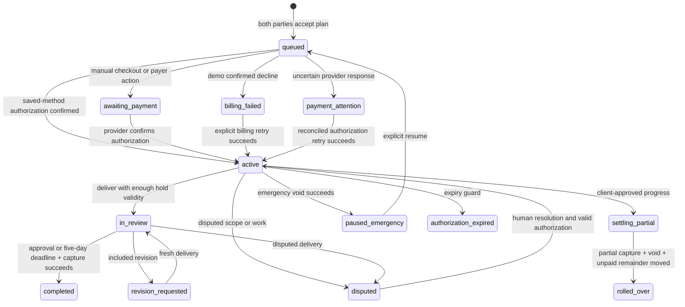

# Agile engine architecture and production boundaries

> Step 1 (2026-11-03) uses the same FastAPI/PostgreSQL/frontend foundation with a separate deterministic agreement lifecycle. Fixed-role Step 1 accounts cannot call the payment or AI decision APIs described here. See [STEP1_IMPLEMENTATION.md](STEP1_IMPLEMENTATION.md) and [PLATFORM_STATUS.md](PLATFORM_STATUS.md). The engine below is preserved for historical projects.

## Implementation decisions

Agile v2 is added alongside v1, with new immutable accepted plans and explicit engine versioning. The accepted source plan remains in `original_plan`; operational milestones can gain an approved carry-over. The contract/plan hash binds acceptance to exact initial terms. The audit log records additional consent and progress evidence. Existing stored agreements are preserved.

The UI stays on the existing HTML/CSS/JavaScript stack. FastAPI remains the only application server, so state-machine and financial rules are shared by UI actions and the scheduled scanner. A Next.js migration can consume the same API later without changing payment rules. SQLite and a single asyncio worker remain hackathon choices, not horizontal-scaling infrastructure.

## State model

Full and partial settlement cannot run on disputed work. Expiry and emergency pause preserve an open dispute. The app refuses to deliver against an authorization too short to fit five review days plus a one-day buffer. It does not silently shorten a client's review rights.

## Continuous consent and token handling

The default integration uses a hosted PayPal Wallet save flow rather than direct card fields. That avoids passing raw payment-card data through FairFlow. Configure merchant eligibility first; there is no bypass for unsupported Vault or merchant-initiated-payment access.

The flow is setup token -> hosted PayPal approval -> server checks APPROVED -> payment token exchange -> server-only stored token -> new AUTHORIZE order -> authorization confirmation. PayPal can still require additional buyer action. A return URL alone is never treated as authorization.

Consent covers the reviewed baseline and its specified amounts. Additions remain proposed until both parties separately accept the visible scope/price. Funding is sequential: a proposed addition does not charge instantly or interrupt an existing milestone. Once accepted, it is queued and can use the saved method when it reaches its turn. Revocation blocks future saved-method authorizations, while existing authorized obligations require their own settlement or cancellation process.

The local prototype is an operator console. Party acceptance is operator-recorded, not identity-verified. Token IDs are removed from project API responses, but SQLite is not an encrypted production vault. Use encrypted secret storage, token-scoped access controls, authenticated identities, retention/deletion workflows and actual signed-consent evidence for deployment.

## Pro-rata invariant

For an original milestone of A cents and approved completion P percent:

- Captured cents C = floor(A * P / 100).
- Unpaid remainder R = A - C.
- C must be greater than zero and less than A.
- A confirmed partial capture uses `final_capture: false`.
- Void the unused authorization before authorizing the remainder elsewhere.
- Merge R and the client-approved remaining scope into the next accepted, unfunded queued milestone; otherwise create a new 14-day carry-over milestone.
- Never add C to a future price.

For example, $300 at 80% yields a $240 capture and $60 carry-over. If the next milestone was $300, it becomes $360. The original $900 total remains $240 + $360 + $300. An unknown capture or void result pauses the workflow and does not start the next hold.

Approval of progress binds to its report ID. Editing progress invalidates that approval. A report contains delivered-work evidence, a URL, the completion percentage and the exact unpaid remainder. Automatic day-28 settlement requires a previously accepted report; without one, the engine voids and pauses rather than taking an unapproved payment. A dispute blocks that automation.

## Recovery and idempotency

Before every remote financial operation, persist a unique operation key and intended amount. After provider confirmation, persist its ID and completion. Final and partial capture use different stable keys. A failed void after a successful partial capture retries only the void; it does not recapture. Confirmed local transitions recover during scanner restart, including completing a captured milestone or merging a remainder after a confirmed void.

Uncertain external responses enter payment_attention. An operator must reconcile provider status before retrying the saved operation. This is not full autonomous provider reconciliation. A production implementation must query current order/authorization/capture state, honor provider retention windows, and reconcile out-of-order webhooks and settlement reports. Do not replay arbitrary old requests merely because their local operation keys exist.

All local mutations and scheduled scans share one process lock. This prevents in-process races, but it is not a distributed lock. Run one worker only. PostgreSQL transactions, row locks/version checks, a transactional outbox, durable job claims and a financial ledger are required for multiple API/worker instances.

## Payment claims corrected

The 29-day window is PayPal-specific behavior, not a universal legal rule for Stripe and all gateways. The source of truth is the provider's authorization expiry. FairFlow retains an expiry returned by PayPal, with the documented 29-day window as a fallback for its PayPal adapter.

The first three days are the honor period. Being inside day 29 does not eliminate risk declines, issuer failures, revoked credentials or disputes. A five-day review on a 21-day sprint fits the nominal period, but cannot guarantee settlement. FairFlow does not promise infinite holds, guaranteed payment, instantaneous balance restoration, or freedom from chargebacks.

The platform requests saved-method authorizations only within recorded consent. Vaulting does not grant unrestricted authority to charge a model-generated quote. Partial capture needs provider support and appropriate merchant enablement. Merchant eligibility and available products vary by account and region.

## Remaining launch work

1. Separate authenticated client/freelancer accounts, project-scoped RBAC and verified consent evidence. Remove shared operator controls.
2. Provider-approved marketplace onboarding, seller identity checks, seller payouts, platform fees and reconciliation. Current captures belong to the configured merchant.
3. Automated provider state retrieval, webhook-to-ledger reconciliation, refunds, reversals, chargeback handling and human dispute operations.
4. PostgreSQL normalized ledger, durable outbox/queue, distributed concurrency control, migrations, backups and disaster recovery.
5. Encrypted token storage, secret manager, rate limits, CSRF/session hardening, AI spend caps, threat modeling and security review.
6. Delivery notifications and reminder outbox, evidence access checks, object storage, immutable deliverable versions and agreed extensions when systems fail.
7. Evaluation datasets for scope extraction and classification, prompt-injection tests, source citations for contract clauses, calibrated abstention and human appeals. Do not use self-reported model confidence as calibrated probability.
8. Legal review for actual jurisdictions and business model; product terms must distinguish authorization, capture, disbursement and any separate escrow or guarantee product.

## Sources checked

- PayPal authorization and honor period: https://developer.paypal.com/payment-methods/auth-honor/
- PayPal recurring payments and consent: https://developer.paypal.com/v5/checkout/recurring-payments
- PayPal stored credentials: https://developer.paypal.com/platforms/checkout/standard/customize/save-payment-methods-for-recurring-payments/
- Setup tokens: https://developer.paypal.com/api/payment-tokens/v3/setup-tokens-create/
- Payments API: https://developer.paypal.com/api/payments/v2

These sources describe provider behavior and requirements. They do not certify this prototype's merchant eligibility or legal status.
