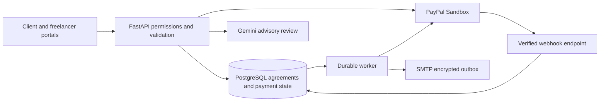

# FairFlow hackathon review

Updated 2026-11-05. This is the current handoff for the fixed-role client and freelancer portals; older roadmap and legacy-demo documents describe earlier implementations.

## Project and flow

FairFlow helps a client and freelancer agree on specific work, detect contradictory terms before signing, and track milestone payment through PayPal Sandbox. Its strongest demonstration is the connection between a versioned agreement, independent consent, delivery evidence, and guarded payment actions. AI advises participants; it cannot sign, change a signed price, or authorize a payment.

1. Register separate client and freelancer accounts and verify them. Local email preview is a development shortcut; SMTP mode requires verification through the actual mailbox.
2. The client creates a brief and invites the freelancer. A four-step builder collects parties, work, schedule, price, review, revision and other contract terms.
3. Participants negotiate in turn. Mandatory fields and structured contradictions block sending/signing. Chat amounts, currency differences and explicit dates produce clarification issues; Gemini adds advisory review and individually applied suggestions.
4. Each sent version is immutable. Both parties approve and sign the exact same hash. HTML, JSON and PDF exports derive from those terms.
5. The freelancer configures a Sandbox receiving email. The client approves PayPal checkout for the next signed milestone, then FairFlow verifies authorization with PayPal. Returning from checkout is not proof of funding.
6. The freelancer submits a delivery URL. The client may approve, request an included revision, or raise a dispute. Revisions/disputes pause release; an internal dispute needs matching confirmation from both participants to resume.
7. Approval requests merchant capture, then a separate freelancer payout. If both signed auto-accept and the recipient was confirmed at checkout, the worker can perform that release after the review deadline without a client session. Existing payments are not silently enrolled.
8. Only a matching individual PayPal payout item with SUCCESS is shown as received. Expired authorizations, uncertain operations and adverse provider events stop the affected workflow for review.



## Stack and technical terms

| Component | Implementation and purpose |
|---|---|
| Browser | HTML, CSS and vanilla JavaScript; separate portals, responsive layouts, themes, autosave and chat |
| API server | Python, FastAPI and Uvicorn; Pydantic validates request shapes |
| Persistence | PostgreSQL, SQLAlchemy and Alembic migrations; SQLite used for isolated tests |
| Identity | Argon2id password hashes, HttpOnly session cookies, CSRF tokens, role/membership checks and idle expiry |
| AI | Gemini through HTTP adapters; schema validation and deterministic rules surround advisory output |
| Payments | PayPal Sandbox Orders/Payments and Payouts APIs, plus signature-verified webhook ingestion |
| Background work | Database jobs, leases, heartbeats and bounded retries; dedicated Python worker |
| Secrets and mail | Environment configuration, Fernet encryption for stored sensitive payloads, SMTP over TLS |
| Exports | ReportLab PDF; canonical JSON and HTML clause rendering |
| Verification | pytest, FastAPI TestClient, Playwright, disposable PostgreSQL databases |
| Local deployment | Docker Compose PostgreSQL and PowerShell launcher; separate API and worker processes |

An **agreement hash** fingerprints exact terms. **Idempotency keys** identify a provider operation so retries can be recognized. A **row lock** serializes competing state changes. An **outbox** persists an intended notification before a worker sends it. A **lease** allows crashed work to be reclaimed. **Reconciliation** compares local records with provider status. **Authorization** permits a later collection; **capture** collects into the merchant account; **payout** separately transfers to the recipient. These are distinct states.

## Feature audit

| Area | Current result | Remaining limitation |
|---|---|---|
| Identity and access | Fixed roles, verification/reset, CSRF, throttling, idle expiry, sessions and project isolation | No OIDC, production abuse service or independent security audit |
| Agreement builder | Required/conditional fields, integer monetary units, sum/date/review-window validation | Free-form prose cannot be exhaustively validated; legal suitability is not established by validation |
| Negotiation and signing | Turn ownership, immutable snapshots, bilateral warning acknowledgment, exact-hash approval/signature, exports | No external identity/signature trust service |
| Conversation and AI | Persistent chat, field references, deterministic price/currency/date checks, Gemini review | No guarantee of detecting every semantic conflict; multilingual and real-case evaluation remains limited |
| Authorization | Buyer approval, provider verification, currency gating, expiry checks and honor-period refresh | No seamless replacement funding after expiry; renewal does not extend the original authorization lifetime |
| Delivery and revisions | Delivery link, included-revision counts, resubmission and refreshed review window | No uploaded immutable artifact storage, malware scanning or objective proof that a URL contains acceptable work |
| Silence and objections | Signed opt-in timer, recipient snapshot, reminders, atomic approval/timeout competition, revision/dispute pause | Requires an operating worker; unresolved disputes can outlast authorization |
| Capture and payout | Persisted operation IDs, separate committed capture/payout states, one payout intent, verified individual receipt | Merchant balance/fees and Payouts eligibility matter; unknown payout batch IDs require manual provider investigation |
| Recovery and webhooks | Stale-operation detection, expiry monitoring, payout polling, capture checks and verified adverse-event pauses | No complete provider-dispute/refund case-management UI; not all possible provider events have bespoke handling |
| Notifications | In-app notices plus encrypted SMTP outbox and TLS sender | Sender/provider not configured locally; uncertain sends are not blindly retried; no deliverability/bounce dashboard |
| Completion display | Completed projects depend on verified payouts; revision counts use recorded requests | Reconciliation must keep running for updated provider state |
| Accounting | Step 1 gross capture, payout receipt and payout return postings; participant settlement history | Fees, taxes, capture refund adjustments, historical backfill and full financial reporting remain unfinished; see FEATURE_AUDIT.md |
| Refunds, partial work, additions | Legacy engine has some related workflows | No equivalent complete fixed-role Step 1 flow; do not claim those legacy features are usable from the current portals |
| Amendments/deposits | Unfunded bilateral amendments; checkout rejects unsupported upfront-deposit terms | Funded amendments and deposit collection are not implemented |
| Worldwide use | International profile/contract data and currency formatting | Contract currency support is broader than merchant funding eligibility; no FairFlow currency-conversion service |

## Changes completed in the resumed audit

The preceding interrupted work added the signed automatic-release timer, reminders, revision/dispute controls, authorization refresh, provider-event routing, SMTP transport and real-mailbox re-verification. It also added cross-currency/date chat checks, completion/revision displays, browser coverage and the readiness command. These files were present when this chat resumed.

The resumed review found that Step 1-only workers could claim legacy jobs, skip their handlers, then mark them done. Claiming now filters to Step 1 scans and mail, preserving older jobs for an appropriate worker. A regression test verifies that legacy jobs retain queued status and zero attempts, while current jobs are claimable.

Verification results are recorded in PLATFORM_STATUS.md after the current runs finish. A prior interrupted full run had 350 passes, three skips and one authentication failure; do not use that run as a clean result. The focused resumed payment/email run passed 14 tests. Provider calls in these tests are mocked. An earlier live Gemini synthetic probe is recorded in the previous chat; it is not a broad quality benchmark. The historical offline scope dataset has only 12 synthetic cases (8 exact matches), so it is not evidence of production AI accuracy.

## Demo runbook

1. Start Docker Desktop, then run `./run.ps1`. Open `http://127.0.0.1:8000/client/login` and a separate browser profile at `/freelancer/login`.
2. Use a fresh short USD agreement within the configured merchant's enabled currencies. Show a deliberate amount-total mismatch being blocked, then correct it. Show the chat clarification and both signatures.
3. Configure a freelancer Sandbox recipient and review the signed auto-accept setting. Start checkout as the client and use a Sandbox buyer account. Verify authorization after returning.
4. Deliver a URL as the freelancer. Request a revision as the client, show that release is paused, then resubmit.
5. Approve and inspect separate capture and payout status. Do not describe a pending batch as received; refresh until the matching item is confirmed.
6. Demonstrate deadline/race/expiry scenarios through the isolated tests. Do not edit real project clocks or signed data to speed up a demo.
7. Show audit evidence, agreement PDF and the worker-health display. Keep a recorded successful Sandbox run as backup for provider/network failures.

Useful commands:

```powershell
venv/Scripts/python.exe -m pytest -q
venv/Scripts/python.exe -m scripts.verify_step1_postgres
venv/Scripts/python.exe -m scripts.hackathon_readiness
node --check static/portals.js
```

## External setup and unfinished work

The local readiness check on resumption found PostgreSQL at migration `0004_sandbox_payouts`, PayPal/Gemini configuration present, local email mode, no webhook ID, no project-owned `.git` directory and no license. Credential presence does not establish provider acceptance. License selection remains yours, as requested.

Follow EMAIL_SETUP.md for actual mailbox delivery. For webhooks, deploy a reachable HTTPS listener, register `/api/webhooks/paypal` on the same Sandbox app and set its ID in `PAYPAL_WEBHOOK_ID`. Test with events from real Sandbox transactions: PayPal's API postback verification does not support simulator mock events. The implementation specifically pauses for authorization void, capture refund/reversal and dispute-created events. See [PayPal webhook setup](https://developer.paypal.com/api/rest/webhooks/rest/).

Before presenting, finish actual Sandbox buyer-to-recipient verification, choose a license, prepare the repository/submission and record the demo. Nothing was published by this review. Public hosting also needs HTTPS, secure configuration, durable API/worker supervision, monitoring and backups.

Before real-money use, resolve payment-provider eligibility and seller onboarding, financial ledger integration, refund/cancellation/partial-settlement flows, funded amendments, artifact storage, operational recovery, security review and jurisdiction-specific obligations. These are not completed by switching Sandbox credentials to live ones.

PayPal describes a 29-day authorization with a three-day honor period; collection after the honor period depends on risk assessment and fund availability. Therefore the correct claim is **milestone payment assurance with guarded release**, not guaranteed payment or licensed escrow. See [PayPal authorization guidance](https://developer.paypal.com/payment-methods/auth-honor/). The current merchant-capture-plus-payout design also needs a separately successful transfer; see [PayPal Payouts](https://developer.paypal.com/api/payouts).
